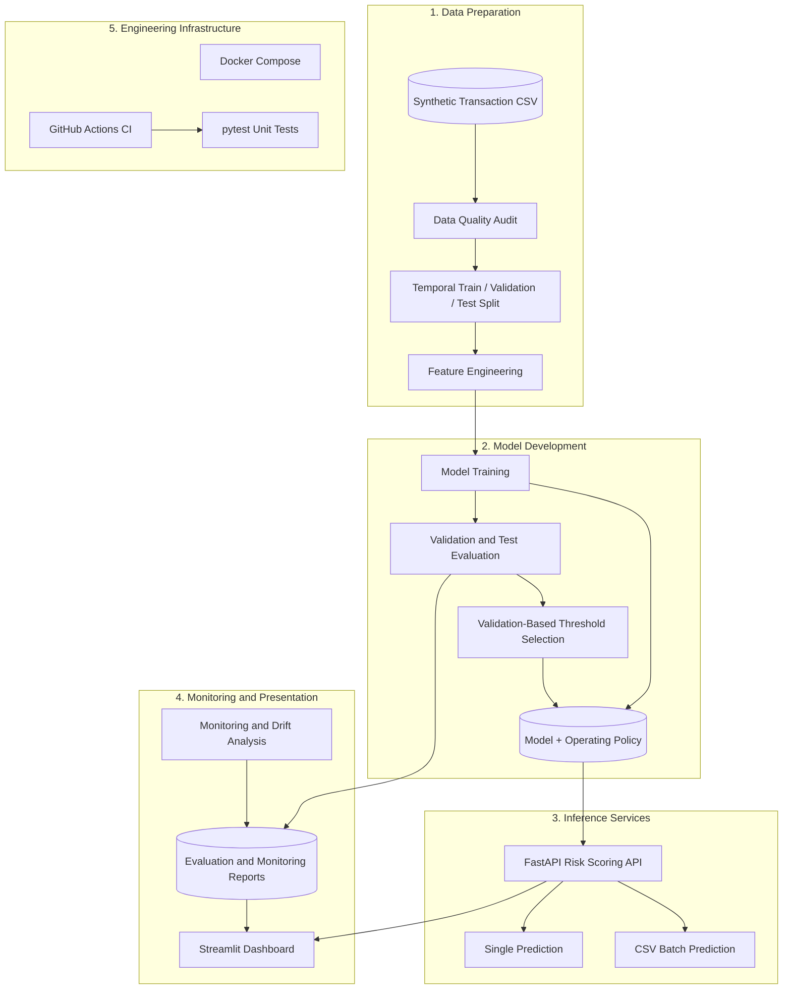

# 🛡️ FinTech Fraud Risk Intelligence Platform

### An End-to-End Machine Learning System for Transaction Risk Scoring, Fraud Analysis, and Model Monitoring

<p align="center">
  
  
  
  
  
  
  
</p>

A portfolio-grade machine learning engineering project that demonstrates how a fraud detection model can be developed, evaluated, served through an API, and monitored through an interactive dashboard.

The platform combines **leakage-aware data preparation, temporal model evaluation, validation-based decision thresholds, batch inference, monitoring reports, automated testing, and containerized services** in one modular repository.

> **Research and demonstration project:** This implementation uses synthetic PaySim-style transaction data. Its evaluation results are experimental findings, not evidence of performance on real banking transactions. It is not intended for direct use in financial production systems.

---

## 📌 Table of Contents

- [Project Overview](#-project-overview)
- [Key Capabilities](#-key-capabilities)
- [System Architecture](#-system-architecture)
- [Model Evaluation](#-model-evaluation)
- [Engineering Decisions](#-engineering-decisions)
- [Technology Stack](#-technology-stack)
- [Getting Started](#-getting-started)
- [Docker Deployment](#-docker-deployment)
- [API Reference](#-api-reference)
- [Project Structure](#-project-structure)
- [Testing and Continuous Integration](#-testing-and-continuous-integration)
- [Monitoring and Observability](#-monitoring-and-observability)
- [Limitations and Responsible Use](#-limitations-and-responsible-use)
- [Roadmap](#-roadmap)
- [Documentation](#-documentation)

---

## 🎯 Project Overview

Financial fraud detection is an imbalanced classification problem: fraudulent transactions are rare, while missed fraud and unnecessary investigations both have business costs.

This project explores the complete model lifecycle rather than stopping at model training.

| Challenge | Implementation |
|---|---|
| Data reliability | Data quality checks and validation |
| Temporal leakage | Chronological train, validation, and test splits |
| Fraud class imbalance | Precision, recall, F1, and average precision |
| Decision optimization | Operating threshold selected on validation data |
| Model accessibility | REST API using FastAPI |
| High-volume input workflows | CSV batch prediction |
| Operational visibility | Streamlit dashboard and monitoring reports |
| Reproducibility | Configuration files, scripts, and saved model artifact |
| Deployment consistency | Dockerfiles and Docker Compose |
| Regression protection | Automated unit tests and GitHub Actions |

## ✨ Key Capabilities

**Data engineering**
- Transaction data quality auditing.
- Configurable temporal splitting.
- Feature engineering for transaction risk analysis.
- Reusable ingestion, quality, and splitting modules.

**Machine learning**
- Scikit-learn model training and evaluation.
- Validation-driven threshold selection.
- Held-out temporal test evaluation.
- Business-cost analysis using explicitly stated illustrative assumptions.

**Inference and user interface**
- Single-transaction risk scoring.
- CSV batch prediction and downloadable results.
- Input validation and API error handling.
- Interactive Streamlit dashboard for risk analysis and monitoring.

**ML engineering**
- Serialized model and operating-policy artifacts.
- Temporal drift and monitoring reports.
- Unit testing with pytest.
- Docker-based API and dashboard services.
- GitHub Actions CI workflow.

---

## 🏗️ System Architecture

The following diagram illustrates the major components and their relationships.



### Transaction inference flow

1. A client submits a transaction or uploads a CSV file.
2. The API validates the incoming data.
3. The feature engineering module prepares the transaction features.
4. The saved model generates a fraud score.
5. The score is compared with the configured operating threshold.
6. The API returns a risk decision or a downloadable batch result.
7. Evaluation and monitoring reports help users inspect model behavior.

The architecture separates data preparation, model development, inference, and presentation so that individual components can be tested and maintained independently.

---

## 📊 Model Evaluation

### Held-out temporal test results

The following metrics come from the project's saved test evaluation report.

| Metric | Result |
|---|---:|
| Test transactions | 89,466 |
| Actual fraud cases | 1,252 |
| Fraud prevalence | 1.40% |
| Average precision (AP) | 0.7494 |
| Precision | 29.70% |
| Recall | 94.57% |
| F1 score | 0.4521 |
| Selected threshold | 0.87 |
| Alert rate | 4.46% |
| True positives | 1,184 |
| False positives | 2,802 |
| False negatives | 68 |

### Interpreting the results

- **Recall of 94.57%:** the model flagged 1,184 of the 1,252 fraudulent transactions in the held-out test set.
- **Precision of 29.70%:** roughly 30% of flagged transactions were fraudulent in this test set.
- **Average precision of 0.7494:** summarizes precision-recall performance across score thresholds.
- **Alert rate of 4.46%:** approximately 4.46% of test transactions were flagged for review.

### An important operational finding

The operating threshold was selected using validation data with these targets:

- Maximum alert rate: 3%.
- Minimum recall: 90%.

The selected threshold achieved a validation alert rate of approximately **2.75%** and recall of approximately **90.34%**.

On the later held-out test set, recall remained high at approximately **94.57%**, but the alert rate rose to **4.46%**. Therefore, the 3% alert-rate constraint did not generalize to the test period.

This illustrates an important real-world ML engineering lesson: a policy that satisfies validation constraints may not satisfy them under changing data distributions.

**The test set was not used to select the threshold.** The reported threshold is 0.87, and the model's scores should not be treated as calibrated probabilities.

The results are from synthetic data; they should not be interpreted as expected performance in a real financial institution.

---

## 🧠 Engineering Decisions

### 1. Temporal evaluation instead of random splitting

Transaction patterns can change over time. Training on randomly mixed historical and future observations can make evaluation overly optimistic.

This project uses chronological splits to evaluate the model on later transactions.

### 2. Separate model scores from decision policies

A model produces a score, while a decision policy determines whether a transaction should be flagged.

Keeping the threshold separate allows the operational policy to be evaluated and adjusted without automatically retraining the model.

### 3. Evaluate more than accuracy

With rare fraud cases, accuracy alone can hide poor fraud detection performance.

The project evaluates average precision, precision, recall, F1, false positives, false negatives, and alert rate.

### 4. Include business-cost assumptions

The evaluation reports use illustrative costs to compare operational trade-offs. These assumptions are not actual bank loss estimates and would need to be replaced with institution-specific data before real deployment.

### 5. Make monitoring explicit

Temporal drift indicators and monitoring reports provide evidence for further investigation. Drift measurements are descriptive signals; they do not independently prove that a model has degraded.

---

## 🧰 Technology Stack

| Category | Technologies |
|---|---|
| Language | Python |
| Data processing | pandas, NumPy |
| Machine learning | scikit-learn |
| Model serialization | joblib |
| API | FastAPI, Pydantic, Uvicorn |
| Dashboard | Streamlit |
| Testing | pytest |
| Configuration | YAML, JSON |
| Infrastructure | Docker, Docker Compose |
| CI | GitHub Actions |

---

## 🚀 Getting Started

### Prerequisites

- Python 3.12 recommended.
- Git.
- Docker Desktop, if using containerized deployment.

### 1. Clone the repository

```powershell
git clone https://github.com/Rauof-Qadir/fintech-fraud-risk-intelligence-platform.git

cd fintech-fraud-risk-intelligence-platform
```

### 2. Create a virtual environment

```powershell
python -m venv .venv

.\.venv\Scripts\Activate.ps1
```

### 3. Install dependencies

```powershell
python -m pip install --upgrade pip

python -m pip install -r requirements.txt
```

### 4. Run the unit tests

```powershell
$env:PYTHONPATH = "."

python -m pytest tests/unit -v
```

### 5. Start the API

```powershell
uvicorn src.api.main:app --host 127.0.0.1 --port 8000
```

Open the API documentation:

- Swagger UI: http://127.0.0.1:8000/docs
- Health check: http://127.0.0.1:8000/health

### 6. Start the dashboard

Open a second PowerShell terminal, activate the virtual environment, and run:

```powershell
streamlit run dashboard/app.py
```

Open the dashboard at:

http://localhost:8501

**Note:** The checked-in model and reports support the inference and dashboard demonstration. The original dataset and generated split files are excluded from Git because of their size. To reproduce the full training and evaluation workflow, obtain the appropriate dataset separately and follow the repository's configuration and data-preparation scripts.

---

## 🐳 Docker Deployment

The project provides separate Docker images for the API and dashboard, orchestrated through Docker Compose.

### Build and start

```powershell
docker compose build

docker compose up -d
```

### Service endpoints

| Service | URL |
|---|---|
| Streamlit dashboard | http://localhost:8501 |
| FastAPI | http://localhost:8000 |
| Interactive API documentation | http://localhost:8000/docs |
| API health check | http://localhost:8000/health |

### Inspect services

```powershell
docker compose ps

docker compose logs api

docker compose logs dashboard
```

### Stop the services

```powershell
docker compose down
```

The containers run the existing model artifact and application services; Docker deployment alone does not make this system production-ready.

---

## 🔌 API Reference

### `GET /health`

Checks whether the API is running and the model is loaded.

Example:

```powershell
Invoke-RestMethod http://localhost:8000/health
```

Expected response:

```json
{
  "status": "ok",
  "model_loaded": true
}
```

### `POST /predict`

Submit one transaction as JSON.

Example request:

```json
{
  "step": 100,
  "type": "TRANSFER",
  "amount": 250000,
  "oldbalanceOrg": 300000,
  "oldbalanceDest": 1000
}
```

Example response format (illustrative values):

```json
{
  "fraud_score": 0.92,
  "threshold": 0.87,
  "decision": "REVIEW",
  "model_name": "baseline_sgd"
}
```

The response score above is an example to illustrate the API schema, not an actual prediction for the example transaction. The model score is not calibrated and should not be interpreted automatically as a true fraud probability.

### `POST /predict/batch`

Upload a CSV file to obtain a downloadable CSV containing predictions.

The endpoint accepts CSV uploads up to 5 MB. Input columns must match the requirements of the batch inference and feature engineering modules.

For the complete request schemas and interactive testing interface, visit:

http://localhost:8000/docs

---

## 📂 Project Structure

```text
fintech-fraud-risk-intelligence-platform/
├── .github/
│   └── workflows/
│       └── tests.yml
├── configs/
│   ├── config.yaml
│   └── split_config.yaml
├── dashboard/
│   ├── app.py
│   └── monitoring_dashboard.py
├── docs/
│   └── MODEL_CARD.md
├── models/
│   └── baseline_sgd.joblib
├── reports/
│   ├── baseline_validation_metrics.json
│   ├── data_quality_report.json
│   ├── final_test_metrics.json
│   ├── operating_policy.json
│   ├── temporal_drift_report.json
│   ├── temporal_split_report.json
│   ├── threshold_analysis.csv
│   └── validation_monitoring_report.json
├── scripts/
│   ├── analyze_temporal_drift.py
│   ├── analyze_thresholds.py
│   ├── audit_dataset.py
│   ├── create_temporal_splits.py
│   ├── evaluate_test.py
│   ├── run_monitoring.py
│   └── select_operating_policy.py
├── src/
│   ├── api/
│   ├── data/
│   ├── evaluation/
│   ├── features/
│   ├── inference/
│   ├── models/
│   └── monitoring/
├── tests/
│   └── unit/
├── .dockerignore
├── .gitignore
├── Dockerfile.api
├── Dockerfile.dashboard
├── docker-compose.yml
├── README.md
└── requirements.txt
```

---

## 🧪 Testing and Continuous Integration

Unit tests cover core areas including:

- API behavior.
- Batch inference.
- Feature engineering.
- Data ingestion.
- Monitoring metrics.
- Data quality.
- Temporal splitting.

Run the test suite locally:

```powershell
$env:PYTHONPATH = "."

python -m pytest tests/unit -v
```

GitHub Actions automatically runs the unit tests on pushes and pull requests targeting `main` or `master`.

[**View GitHub Actions runs →**](https://github.com/Rauof-Qadir/fintech-fraud-risk-intelligence-platform/actions)

---

## 📈 Monitoring and Observability

The repository includes evaluation and monitoring artifacts to support analysis of model behavior.

| Artifact | Purpose |
|---|---|
| `data_quality_report.json` | Summarizes data quality checks |
| `temporal_split_report.json` | Documents the chronological data split |
| `baseline_validation_metrics.json` | Stores baseline validation results |
| `operating_policy.json` | Records the selected operating threshold and constraints |
| `final_test_metrics.json` | Stores held-out test metrics |
| `temporal_drift_report.json` | Summarizes temporal drift measurements |
| `validation_monitoring_report.json` | Stores validation monitoring results |
| `threshold_analysis.csv` | Supports threshold trade-off analysis |

These reports are intended to make evaluation decisions inspectable rather than relying only on a headline metric.

---

## ⚠️ Limitations and Responsible Use

This repository is an educational and portfolio project, with several important limitations.

- **Synthetic data:** results may not generalize to real financial transactions.
- **Uncalibrated scores:** the model output is not established as a calibrated fraud probability.
- **Illustrative costs:** the cost model is not based on actual financial institution loss data.
- **Operational constraints:** the 3% alert-rate target was met on validation data but not on the held-out test data.
- **Temporal drift:** observed distribution changes require investigation and do not alone prove model failure.
- **Production readiness:** authentication, authorization, audit storage, production secrets management, load testing, calibrated risk estimates, and deployment-specific monitoring would require additional work.

Fraud decisions should be evaluated with domain experts, clear review procedures, and appropriate governance before any real-world use.

---

## 🗺️ Roadmap

Potential next improvements:

- [ ] SHAP-based feature explanations for individual predictions.
- [ ] More comprehensive API integration and Docker smoke tests.
- [ ] Input schema and model input drift alerts.
- [ ] Model performance tracking when delayed labels become available.
- [ ] Benchmarking inference latency and batch throughput.
- [ ] Model and data version tracking.
- [ ] Stronger API security and audit logging.
- [ ] Reproducible model retraining workflow.
- [ ] Dashboard screenshots and a recorded end-to-end demo.

---

## 📚 Documentation

- [Model Card](docs/MODEL_CARD.md)
- [Source Code](src/)
- [Unit Tests](tests/unit/)
- [GitHub Actions](.github/workflows/tests.yml)
- [Repository](https://github.com/Rauof-Qadir/fintech-fraud-risk-intelligence-platform)

---

<p align="center">
  <strong>Built as a practical demonstration of end-to-end machine learning engineering.</strong>
  <br>
  Data Quality · Temporal Evaluation · Risk Scoring · API Engineering · Monitoring · CI/CD
</p>
